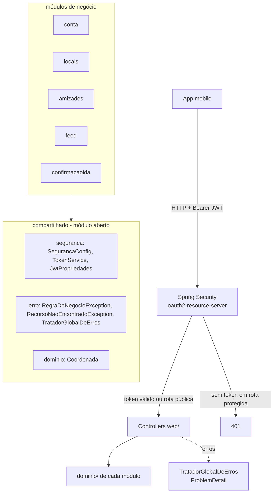

# Estrutura do Backend Design

**Spec**: `.specs/features/estrutura-backend/spec.md`
**Status**: Referência para tasks futuras. Não será implementado de uma vez: o projeto parte de pastas vazias (AD-013 em `docs/decisões.md`).

---

## Architecture Overview

Monólito modular com Spring Modulith. Cada módulo de negócio é um pacote direto de `br.com.mapae` e se divide em camadas leves: `dominio/` (classes e regras em Java puro, interfaces de repositório) e `web/` (controllers), com `aplicacao/` entrando quando houver casos de uso. Módulos não importam classes uns dos outros: as referências entre agregados são feitas por ID (`Long`), exatamente como no diagrama de classes. O módulo `compartilhado` é aberto (`Type.OPEN`) e concentra o que todos usam: exceções e tratamento de erro, segurança e o value object `Coordenada`.



Estrutura de pacotes final:

```
br.com.mapae
├── MapaeApplication
├── compartilhado/          package-info: @ApplicationModule(type = OPEN)
│   ├── dominio/            Coordenada
│   ├── erro/               RegraDeNegocioException, RecursoNaoEncontradoException, TratadorGlobalDeErros
│   └── seguranca/          SegurancaConfig, JwtPropriedades, TokenService
├── conta/
│   ├── dominio/            Usuario, UsuarioRepositorio
│   └── web/                ContaController
├── locais/
│   └── dominio/            Local, Categoria, LocalRepositorio, CategoriaRepositorio
├── amizades/
│   └── dominio/            Amizade, StatusAmizade, AmizadeRepositorio
├── feed/
│   └── dominio/            Publicacao, TipoPublicacao, Comentario, Curtida, PublicacaoRepositorio
└── confirmacaoida/
    └── dominio/            ConfirmacaoIda, ConfirmacaoIdaRepositorio
```

---

## Code Reuse Analysis

### Existing Components to Leverage

| Component | Location | How to Use |
| --------- | -------- | ---------- |
| Projeto gerado pelo Initializr | `pom.xml` | Manter parent Boot 4.1.2, Spring Modulith 2.1.1 (BOM), devtools e configuration-processor; trocar `groupId`, `java.version` e adicionar starters |
| Classe principal | `src/main/java/com/example/mapaebackend/MapaeBackendApplication.java` | Mover para `br.com.mapae.MapaeApplication` |
| Teste de contexto | `src/test/java/com/example/mapaebackend/MapaeBackendApplicationTests.java` | Mover e acrescentar a verificação do Modulith |
| Maven Wrapper | `mvnw`, `.mvn/` | Usar como está |

### Integration Points

| System | Integration Method |
| ------ | ------------------ |
| App mobile | REST JSON em `/api/v1`, header `Authorization: Bearer <jwt>` |
| Banco de dados | Nenhuma nesta entrega (AD-003); repositórios são interfaces sem implementação |

### Dependências Maven (versões gerenciadas pelo parent 4.1.2)

| Artifact | Scope | Motivo |
| -------- | ----- | ------ |
| `spring-boot-starter-webmvc` | compile | API REST |
| `spring-boot-starter-validation` | compile | Bean Validation (ERR-01) |
| `spring-boot-starter-security` | compile | Filtro de segurança, BCrypt |
| `spring-boot-starter-oauth2-resource-server` | compile | Validação de JWT, `NimbusJwtEncoder/Decoder` |
| `spring-boot-starter-actuator` | compile | `/actuator/health` (EST-03) |
| `spring-boot-starter-webmvc-test` | test | MockMvc |
| `spring-boot-starter-security-test` | test | Utilitários de teste de segurança |

Nomes conferidos no BOM `spring-boot-dependencies-4.1.2.pom` do repositório Maven local.

---

## Components

### MapaeApplication

- **Purpose**: Ponto de entrada e raiz da varredura do Spring e do Modulith.
- **Location**: `src/main/java/br/com/mapae/MapaeApplication.java`
- **Interfaces**: `main(String[])`; `@ConfigurationPropertiesScan` para registrar `JwtPropriedades`.
- **Dependencies**: nenhuma
- **Reuses**: `MapaeBackendApplication` gerada

### compartilhado (módulo aberto)

- **Purpose**: Código usado por todos os módulos.
- **Location**: `src/main/java/br/com/mapae/compartilhado/package-info.java`
- **Interfaces**: `@ApplicationModule(type = ApplicationModule.Type.OPEN)` - os subpacotes ficam visíveis para os outros módulos sem violar a verificação (EST-02).
- **Dependencies**: `spring-modulith-api` (já vem no `spring-modulith-starter-core`)

### Coordenada

- **Purpose**: Substitui o tipo `Point` do diagrama enquanto não há PostGIS.
- **Location**: `compartilhado/dominio/Coordenada.java`
- **Interfaces**:
  - `record Coordenada(double latitude, double longitude)` - construtor compacto lança `IllegalArgumentException` fora de [-90, 90] / [-180, 180] (DOM-10)
  - `double distanciaEmKmAte(Coordenada outra)` - Haversine com raio 6371 km (DOM-11)

### Exceções e TratadorGlobalDeErros

- **Purpose**: Formato único de erro em `ProblemDetail` (ERR-01 a ERR-03).
- **Location**: `compartilhado/erro/`
- **Interfaces**:
  - `RegraDeNegocioException extends RuntimeException` - violação de regra do domínio, vira `422`
  - `RecursoNaoEncontradoException extends RuntimeException` - vira `404`
  - `TratadorGlobalDeErros` - `@RestControllerAdvice extends ResponseEntityExceptionHandler`; sobrescreve `handleMethodArgumentNotValid` para adicionar a propriedade `erros` (lista de `{campo, mensagem}`) e trata as duas exceções acima

### Segurança

- **Purpose**: Autenticação JWT stateless e definição das rotas públicas.
- **Location**: `compartilhado/seguranca/`
- **Interfaces**:
  - `JwtPropriedades` - `@ConfigurationProperties("mapae.jwt") record(String segredo, Duration expiracao)`; construtor compacto lança `IllegalArgumentException` se `segredo` for nulo ou tiver menos de 32 bytes em UTF-8, o que impede a subida da aplicação (SEG-07); `expiracao` padrão de 60 minutos
  - `SegurancaConfig` - beans `SecurityFilterChain`, `JwtEncoder` (`NimbusJwtEncoder` com `ImmutableSecret`), `JwtDecoder` (`NimbusJwtDecoder.withSecretKey(...).macAlgorithm(HS256)`), `PasswordEncoder` (`BCryptPasswordEncoder`, SEG-06) e `Clock` (`Clock.systemUTC()`)
  - `TokenService.emitir(Long usuarioId): String` - JWT HS256 com `sub`, `iat` = agora e `exp` = agora + `expiracao` (SEG-03)
- **Regras do filtro**:
  - Sem sessão: `SessionCreationPolicy.STATELESS` (SEG-08); CSRF desabilitado (API stateless sem cookie)
  - `permitAll`: `GET /actuator/health`, `GET /api/v1/locais/**`, `GET /api/v1/categorias/**`, `POST /api/v1/auth/**` (SEG-02, EST-03)
  - Qualquer outra rota: `authenticated()` (SEG-01, SEG-05)
- **Dependencies**: `JwtPropriedades`, `Clock`

### ContaController

- **Purpose**: Prova ponta a ponta de que o token identifica o usuário (SEG-04).
- **Location**: `conta/web/ContaController.java`
- **Interfaces**: `GET /api/v1/conta/eu` → `200 {"id": <sub do token como número>}`; recebe `@AuthenticationPrincipal Jwt`
- **Dependencies**: nenhuma além do Spring Security

### Domínio dos módulos

- **Purpose**: Classes do diagrama (DOM-01) com as regras cobertas pela spec.
- **Location**: `<modulo>/dominio/`
- **Interfaces**: ver Data Models.
- **Dependencies**: `compartilhado.dominio.Coordenada`, `compartilhado.erro.RegraDeNegocioException`; `Usuario` não depende de Spring.

### Repositórios

- **Purpose**: Portas de persistência declaradas agora para a Etapa 3 (DOM-14).
- **Location**: `<modulo>/dominio/<Agregado>Repositorio.java`
- **Interfaces** (iguais para todos): `T salvar(T)`, `Optional<T> buscarPorId(Long)`; `LocalRepositorio` acrescenta `List<Local> buscarPorCategoria(Long categoriaId)`. Sem implementação.

---

## Data Models

IDs são `Long` e ficam `null` até existir persistência. Datas usam `Instant`. Métodos que registram horário recebem o `Instant` como parâmetro, para que os testes não dependam do relógio.

### conta

```java
class Usuario { Long id; String nome; String email; String senhaHash; String fotoUrl; }
```

### locais

```java
class Categoria { Long id; String nome; String icone; }
class Local {
    Long id; String nome; String endereco; Coordenada posicao; String horario;
    int faixaPreco;          // 1..4, senão IllegalArgumentException (DOM-12)
    List<String> fotos; Long categoriaId;
    double distanciaAte(Coordenada p);   // delega para Coordenada (DOM-11)
}
```

### amizades

```java
enum StatusAmizade { PENDENTE, ACEITA, RECUSADA }
class Amizade {
    Long id; Long solicitanteId; Long destinatarioId; StatusAmizade status; Instant criadaEm; Instant respondidaEm;
    Amizade(Long solicitanteId, Long destinatarioId, Instant criadaEm);  // PENDENTE; mesmo id -> RegraDeNegocioException (DOM-02, DOM-06)
    void aceitar(Instant agora);   // só de PENDENTE (DOM-03, DOM-05)
    void recusar(Instant agora);   // só de PENDENTE (DOM-04, DOM-05)
}
```

### feed

```java
enum TipoPublicacao { INDIVIDUAL, COLABORATIVA }
class Publicacao {
    Long id; String texto; TipoPublicacao tipo; List<String> midias; Instant criadaEm; Long localId;
    List<Long> autoresIds;
    Publicacao(Long autorId, TipoPublicacao tipo, String texto, Long localId, Instant criadaEm); // tipo null -> IllegalArgumentException
    void adicionarAutor(Long usuarioId);  // DOM-07, DOM-08, DOM-09
}
class Comentario { Long id; String texto; Instant criadoEm; Long publicacaoId; Long usuarioId; }  // texto em branco -> IllegalArgumentException (DOM-13)
class Curtida { Long id; Instant criadaEm; Long publicacaoId; Long usuarioId; }
```

### confirmacaoida

```java
class ConfirmacaoIda { Long id; Instant dataHora; Coordenada posicao; Long usuarioId; Long localId; }
```

**Relationships**: Publicacao tem 1..* autores (Usuario) e 0..1 Local; Comentario e Curtida pertencem a uma Publicacao e a um Usuario; Amizade liga dois Usuarios; ConfirmacaoIda liga Usuario e Local; Local pertence a uma Categoria. Todas as ligações são por ID.

---

## Error Handling Strategy

| Error Scenario | Handling | User Impact |
| -------------- | -------- | ----------- |
| Sem token ou token inválido/expirado em rota protegida | `BearerTokenAuthenticationEntryPoint` padrão | `401` com header `WWW-Authenticate: Bearer` |
| Corpo inválido (Bean Validation) | `TratadorGlobalDeErros.handleMethodArgumentNotValid` | `400` `ProblemDetail` com `erros: [{campo, mensagem}]` |
| `RecursoNaoEncontradoException` | `@ExceptionHandler` | `404` `ProblemDetail` com `detail` = mensagem |
| `RegraDeNegocioException` | `@ExceptionHandler` | `422` `ProblemDetail` com `detail` = mensagem |
| Segredo JWT ausente ou curto | Construtor de `JwtPropriedades` lança exceção | Aplicação não sobe; mensagem cita `MAPAE_JWT_SECRET` |

---

## Risks & Concerns

| Concern | Location (file:line) | Impact | Mitigation |
| ------- | -------------------- | ------ | ---------- |
| Tech debt: `java.version` 17 e `groupId` `com.example` | `pom.xml:12`, `pom.xml:30` | Diverge de AD-002 e da spec (EST-01, EST-04) | Tarefa de base troca para `br.com.mapae` e 25 |
| Tech debt: `<licenses>`, `<developers>`, `<scm>` vazios gerados pelo Initializr | `pom.xml:16-27` | Ruído no pom | Remover na tarefa de base |
| Segurança: segredo JWT em arquivo versionado | `src/main/resources/application.properties` | Vazamento do segredo | Main usa só `${MAPAE_JWT_SECRET}`; o segredo de teste fica em `src/test/resources` e é falso; `.env` entra no `.gitignore` |
| Segurança: logout não invalida tokens | `TokenService` | Token roubado vale até expirar (máx. 60 min) | Expiração curta agora; denylist em Redis quando o banco entrar (fora do escopo) |
| Incerteza: `ApplicationModules.of` pode incluir classes de teste na análise | `MapaeApplicationTests` | Controller de teste mal posicionado geraria falsa violação | Controller de teste de erros fica dentro de `compartilhado`, que é aberto |

---

## Tech Decisions (only non-obvious ones)

| Decision | Choice | Rationale |
| -------- | ------ | --------- |
| Validação de JWT | `spring-boot-starter-oauth2-resource-server` com chave HMAC, sem filtro próprio | Código mantido pelo Spring Security; menos superfície de erro |
| Visibilidade do `compartilhado` | `@ApplicationModule(type = OPEN)` | Subpacotes de módulo são internos por padrão no Modulith; aberto evita uma `@NamedInterface` por subpacote |
| Horário no domínio | `Instant` passado como parâmetro | Testes determinísticos sem mock de relógio |
| Métodos do diagrama sem regra definida (`autenticar`, `editarPerfil`, `publicar`, `desfazer`, `registrar`) | Ficam para os casos de uso da Etapa 3 | A spec não define comportamento para eles; implementar agora seria inventar regra |
| Ligação entre agregados | Por ID (`Long`), nunca por referência de objeto | Mantém módulos desacoplados e casa com o diagrama (FKs) |
